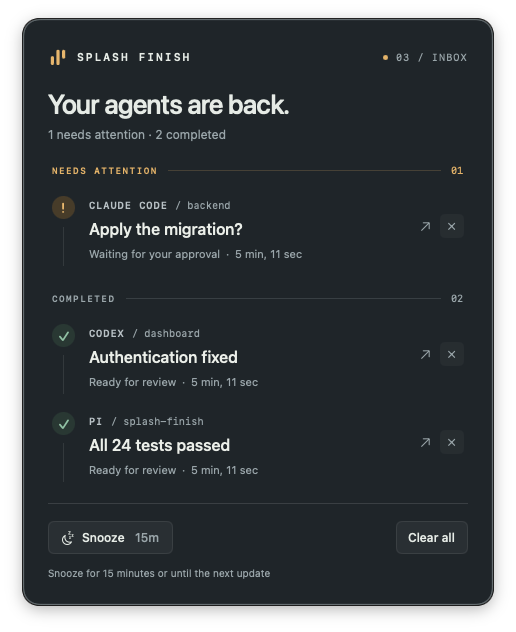

# Splash Finish

A little landing strip for AI agents. **Splash Finish** is a native macOS menu bar app that collects finished work and requests for attention from Claude Code, Codex, and pi in one quiet window. Because one agent interrupting you is a notification; five agents doing it is a committee.



## 🚀 Install

Requires **macOS 14 or later** on Apple silicon or Intel. No Python packages, Homebrew, Xcode, `sudo`, or notification permissions required. Python **3.10+** is needed for the installer.

```sh
curl -fsSL https://raw.githubusercontent.com/bobuk-io/splash-finish/main/install.py \
  | python3 -
```

The installer downloads the latest release, checks its SHA-256 and Developer ID signature, installs `Splash Finish.app` in `~/Applications`, and adds `splash-finish` to the first of `~/.local/bin`, `~/bin`, or `~/.bin` already on `PATH`. Otherwise it uses `~/.local/bin` and prints the line to add to your shell. Run it again to update.

The release is signed with Developer ID and notarized by Apple.

Then connect your agents:

```sh
splash-finish install-skills
```

- **Claude Code:** start a new session to load the hooks and skill.
- **Codex:** open `/hooks`, review and trust the new hooks, then restart if needed. Splash Finish does not bypass Codex's hook trust. Hooks must be enabled in your Codex configuration.
- **pi:** use `/reload` in running sessions, or start a new one. Requires pi **1.5.0+** for the `agent_settled` and `ui_prompt_start` events.

Installation of integrations is explicit. The app will not edit agent settings just because you opened it.

## ✨ Use

The three bars in your menu bar are Splash Finish. One floating panel is shared by all agents:

- **Needs attention** appears above **Completed**. A new result expands the same window; a long list scrolls.
- **×** dismisses one notification. **Clear all** clears the list and hides the panel. Right-click a row to open its source, copy its text, or dismiss it.
- Drag the panel anywhere; it reappears where you left it as long as that screen is still connected.
- **Snooze** hides the panel for 15 minutes or until a genuinely new event arrives, whichever comes first. The menu bar offers 15 minutes, 1 hour, or until tomorrow morning. The inbox is retained, including across app restarts.
- Click a row to return to its source when possible. A supplied session link is preferred; Orca terminal/workspace coordinates and WezTerm pane IDs are captured when available. In Orca, a click switches to the original project, terminal tab and split pane via its CLI. A successful exact transition (source link, Orca terminal or WezTerm pane), whether by `Return`, the card or its arrow, dismisses that notification; if it was the last one, the panel hides. If exact navigation fails, the card stays and Splash Finish activates the originating app; it never chooses another Orca project or launches a replacement agent. Other terminals do not guarantee the original tab or window can be selected.
- Notification titles/details support inline Markdown: **bold**, *italic*, ~~strikethrough~~, `code`, and `[links](https://example.com)`. Web links open in the browser without dismissing the notification; other card clicks still return to the agent. Markdown is parsed before preview clipping, so long destinations do not leak into the label. Block layouts (headings, tables, lists) and images are not rendered.
- The inbox keeps at most the 200 most recent notifications; when it overflows, the oldest entries are dropped even if they were asking for attention.
- Use the menu bar to reopen the inbox, send a test notification, install integrations, or enable **Start at Login**. **Respect Do Not Disturb** hides automatic reveals, including the one at launch, while macOS Focus is on; events still land in the inbox and update the badge, and an explicit `show` always opens it. When the panel appears, it takes keyboard focus: `Esc` snoozes, `Backspace` (or `⌘W`) clears all, `↑` / `↓` select a notification, and `Return` opens its source. A new notification in an already-visible panel does not steal focus back if you switched away.
- `⌥⌘S` opens the inbox from anywhere, even when Splash Finish is not the active app.

```sh
splash-finish show
splash-finish snooze
splash-finish clear
splash-finish status             # short summary of the local inbox
splash-finish status --raw       # full inbox state as JSON
splash-finish doctor             # integration status, repair hints and last event
splash-finish --help
```

A manually reported task looks like this:

```sh
splash-finish notify --agent Codex --task auth-refactor \
  --status done --title 'Authentication fixed' --detail 'Ready for review'

splash-finish notify --agent 'Claude Code' --task migration \
  --status attention --title 'Apply the migration?'
```

Keep `--agent` and `--task` stable for the same session: an update replaces its earlier notification instead of adding a duplicate. A new event wakes snooze; an identical repeated event does not. `--status running` removes an outdated notification without waking the panel. `--project` sets a label; otherwise the current directory name is used. A verified originating session URL can be supplied with `--source-url`.

### Returning to Orca

Agents started in a **local Orca terminal** automatically pass their terminal handle, workspace and pane identity to Splash Finish. This works with pi, Claude Code, Codex and manual `splash-finish notify` calls; no per-project setup is needed. Changing the agent's working directory does not change the captured workspace. For rich pi questions, **Answer in pi** also returns to that terminal (reload the updated question adapter first).

Agents running in Orca's **built-in chat** have no terminal of their own; they pass their chat session identity instead. Clicking such a notification opens that exact chat and brings its workspace on screen, so a chat stays reachable even after you moved on to other work. Chats and terminals are ordered attempts: if one is gone, the other is still tried.

Orca is contacted only when you click a notification, not on every agent event. Splash Finish uses the CLI bundled with the installed Orca app, so Finder's `PATH` does not matter, and it opens chats through Orca's own bundled runtime client rather than reimplementing its protocol. If Orca restarted, it re-discovers the same pane using workspace/tab/pane IDs rather than reusing a stale terminal handle. A closed or unresolvable chat or pane produces an unavailable-source message instead of selecting a different agent. Existing notifications created before this support was added cannot recover coordinates retroactively. Remote/paired Orca runtimes are not supported.

### Deep links

The CLI uses `splash-finish://` URLs; automation can use them too. Percent-encode parameter values:

```sh
open 'splash-finish://event?agent=Codex&task=auth&status=done&title=Authentication%20fixed'
open 'splash-finish://show'
```

`agent`, `task`, and `status` (`done`, `attention`, or `running`) are required. Optional fields: `id` (event replay ID), `title`, `detail`, `project`, `source-pid`, `source-bundle`, and `source-url`. Orca coordinates use `orca-terminal` (runtime handle), `orca-worktree` (workspace identity), `orca-pane` (`tabId:leafId`) and `orca-session` (built-in chat identity); these are captured automatically by the CLI when inherited from Orca. Source URLs accept only `https`, `http`, `vscode`, `vscode-insiders`, `cursor`, `windsurf`, `zed`, `iterm2`, or `codex`. An `id` may be replayed safely; duplicate query parameters are rejected. Optional `run` and `sequence` are non-negative integers and must be provided together. They order updates per agent/task; older generations and non-increasing sequences are ignored, even after dismissing a notification. Once a task sends ordered updates, legacy unordered updates for that same task are ignored while the bounded ordering record remains. Pi supplies these fields; Claude and Codex hooks currently do not expose a reliable common ordering guarantee.

Deep links are not authenticated: any local app can send them. They display bounded local text; Splash Finish never runs commands from a link. Open source links only if you trust the sender.

## 🧰 Agent integrations

```sh
splash-finish install-skills                 # all three
splash-finish install-skills --agent pi      # claude | codex | pi
splash-finish uninstall-skills               # remove all Splash Finish integrations
splash-finish uninstall-skills --agent codex
```

| Agent | What is installed | Signals |
|---|---|---|
| Claude Code | user skill and `~/.claude/settings.json` hooks | `Stop`, `StopFailure`, permission and supported input notifications |
| Codex | user skill and `~/.codex/hooks.json` hooks | `Stop` and `PermissionRequest`; `/hooks` trust required |
| pi | user skill and `~/.pi/agent/extensions/splash-finish.ts` | settled, extension UI prompts, common question tools, errors and interruption |

Pi notifications are fire-and-forget and never delay the agent. User-opened menus while Pi is idle (such as `/jewter`) do not trigger attention notifications or clear completed items; blocking dialogs during an active agent run still report requests for input. Subagent sessions (pi-subagents background children and in-process `run-N` sessions) are filtered: only requests for input are forwarded, so a fan-out of workers does not flood the inbox.

Set `SPLASH_FINISH_DISABLED=1` in managed worker processes (for example pi-selecta workers) to suppress their lifecycle hooks, rich questions and explicit `notify` calls. Leave it unset in the coordinator so only the coordinator asks the human and reports completion. Available in 0.3.8 and later. Pi integrations, installed hook shell guards, and the CLI honor this opt-out. After updating, reinstall integrations with `splash-finish install-skills` and run `/reload` in existing Pi sessions.

Completions mean **the agent stopped responding**, not that its claims or tests were independently verified. Agent hook APIs and external tools vary by version; not every possible request for input is observable. Background agents, remote containers and hosts that do not expose the local macOS app may need to send events explicitly. Claude Code can emit the sandbox network permission notification after a delay. Other installed hooks may change agent behavior after a `Stop` event; Splash Finish is only an observer and cannot predict subsequent continuation.

Open **Integrations…** in the menu bar or run `splash-finish doctor` to inspect installed files, hooks, update availability, and the last recorded event. Codex hook trust is not exposed to the inspector; use `/hooks` to check it. Event timestamps are recorded only by app versions supporting this feature.

The installer preserves unrelated hooks/settings, rejects unmanaged files and symlinked configuration paths, and writes a uniquely named backup before changing an existing JSON config, keeping the three newest backups. Reinstall updates only Splash Finish entries, and the app offers a repair when its version or location changed because hooks embed the absolute path of the binary. Config locations honor `CLAUDE_CONFIG_DIR`, `CODEX_HOME`, and `PI_CODING_AGENT_DIR`. Removal does not delete the app, unrelated hooks, or configuration backups. Existing pi sessions need `/reload` after either operation.

### Rich pi questions

Install [pi-agent-ask](https://github.com/alexshpunt/pi-agent-ask) separately with `pi install npm:pi-agent-ask`. Do not install it alongside another provider of `ask_user`. Splash Finish checks the globally configured package and recommends installation if it is not detected; project-local and manually loaded packages cannot always be detected.

Run `splash-finish install-skills --agent pi` to install the integration. Rich questions are enabled automatically when pi-agent-ask is detected globally; an already-enabled integration is preserved on reinstall. Use the checkbox in **Integrations…** to enable or disable rich questions explicitly, including for project-local installations; the checkbox applies immediately. Run `/reload` in existing pi sessions after changes. Splash Finish never installs or removes pi-agent-ask itself.

The adapter uses pi-agent-ask's documented versioned lifecycle and submit events, without patching its UI. It supports multiple questions, single/multiple choices, custom answers, question and option notes. Submit waits for pi's acknowledgement; if the terminal answers first, the card closes. **Answer in pi** closes the card without answering it; Snooze preserves it; Clear all keeps pending questions. In the card, `⌘1`…`⌘9` toggle options and `⌘Return` submits; plain digits keep working inside the text fields. If the app is unavailable or a form is unsupported, the original pi interface remains available.

Question text and answers travel over a per-request local Unix socket in a user-private directory, not in the deep link or persisted inbox. Other processes running as your user are not a security boundary. A newer or older pi-agent-ask version may change its event contract; version 2.0.2 is the tested baseline.

## 🔒 Local by default

- No accounts, analytics, or servers operated by the app. Sparkle checks the public GitHub update feed, and the **installer** contacts GitHub.
- The inbox is stored in `~/Library/Application Support/Splash Finish/state.json` with private file permissions. Event titles may contain short excerpts from the agent's final response; don't put secrets in them. Source URLs may also be persisted.
- Hooks receive agent-supplied JSON locally, but the app does not store whole transcripts or tool inputs. Titles and details retain at most 4 KiB of UTF-8 text each for Markdown parsing; the compact panel shows only a preview. `status --raw` includes these retained excerpts. Markdown URLs are clickable only for `http`/`https`, without embedded credentials; images/HTML are never loaded.
- Event payloads are bounded; malformed links and unsafe source URL schemes are rejected. Hook failures do not block the agent or approve permissions.
- Opening an external source link is a user-initiated action. App activation is best-effort, not proof of the correct terminal tab.
- This is a menu bar agent, not a background daemon. It runs after you open it (or enable Start at Login); a deep link or the CLI can also launch it.

## 🧹 Uninstall

```sh
splash-finish uninstall-skills
```

Quit Splash Finish from its menu. Remove `~/Applications/Splash Finish.app` and the `splash-finish` symlink from your local bin directory. If you also want to erase the inbox, remove `~/Library/Application Support/Splash Finish`. Existing hook backups are left beside the agent config files for you to inspect or remove.

## 🛠️ Development

```sh
swift test
python3 -m unittest discover -s Tests -v
node Tests/pi-extension.test.mjs       # Node 22.18+ for TypeScript stripping
node Tests/pi-questions.test.mjs
Scripts/compile_and_run.sh --test      # ad-hoc local build
# With an active macOS desktop and no existing Splash Finish process:
SPLASH_FINISH_GUI_TESTS=1 python3 -m unittest discover -s Tests -p test_app_smoke.py -v
```

`Package.swift` builds a SwiftUI/AppKit app and a separate testable core, with the pinned Sparkle binary dependency. `Scripts/package_app.sh` assembles the `.app`; no Xcode project is required. `install.py` is a standalone standard-library installer. Tests use temporary directories and do not alter your agent configs.

The app icon is **Landing Signal** (three raised amber bars on slate). Editable artwork and native-size PNGs live in [`Assets/AppIcon`](Assets/AppIcon/README.md); the build packages them into `Icon.icns` using macOS tools only. The menu-bar symbol remains monochrome.

`version.env` is the single source of truth for the release version: `Scripts/package_app.sh` embeds it in `Info.plist`, the app reads it back for `--version`, and CI verifies the built bundle against the file.

Create a **universal** release with an available Developer ID identity:

```sh
APP_IDENTITY='Developer ID Application: YOUR NAME (TEAMID)' Scripts/release.sh
```

This produces `build/Splash Finish.app`, `dist/SplashFinish-<version>-universal.zip`, and `dist/SHA256SUMS`. The signing identity used by the installer is pinned to the project's Developer ID team; update `TEAM_ID` in `install.py` if the project changes hands. A build without notarization will not pass Gatekeeper on a downloaded file. For a distributable notarized build, configure a `notarytool` keychain profile and run:

```sh
APP_IDENTITY='Developer ID Application: YOUR NAME (TEAMID)' \
  Scripts/release.sh --notarize YOUR_NOTARY_PROFILE
```

The script waits for Apple's response, staples the ticket, checks Gatekeeper, and regenerates the ZIP and checksum. It never creates a GitHub release on its own.

### Sparkle updates

The app embeds Sparkle 2.10.1 and checks the public `releases/latest/download/appcast.xml` feed.

Upload the three assets with `Scripts/publish.sh`: it refuses a build number that is not greater than the published one, refuses to reuse an existing tag, and creates the GitHub release with generated notes.

The Ed25519 private signing key is stored in the macOS login Keychain under account `io.bobuk.splash-finish`. Back it up securely offline: losing it prevents the current app from verifying updates. Never commit or publish it. The public key is embedded in the app. On the signing machine, obtain the verified Sparkle 2.10.1 release tools and set `SPARKLE_BIN` to their `bin` directory, then after notarizing run:

```sh
SPARKLE_BIN=/path/to/Sparkle/bin Scripts/make_appcast.sh
```

Upload `dist/appcast.xml`, the ZIP, and `SHA256SUMS` together to the corresponding GitHub release. Each release needs a higher `BUILD_NUMBER`. `Scripts/make_appcast.sh` verifies the Keychain public key and signs the final archive; do not modify the archive after generating its signature. The public release feed and archives are accessible to Sparkle without authentication.

---

Your agents can go back to work now. You can, too. ☕
